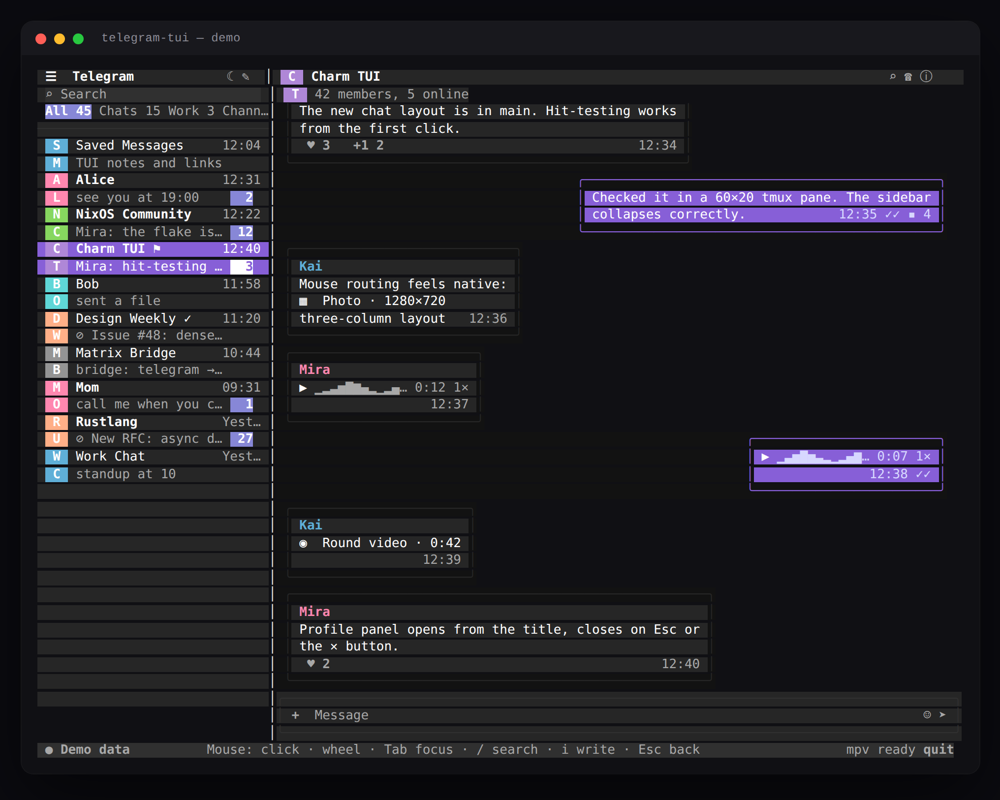

# telegram-tui

Project brief: [`PROJECT.md`](PROJECT.md) · roadmap: [`TODO.md`](TODO.md).

Mouse-first Telegram client for the terminal, built with Bubble Tea v2, Bubbles
v2 and Lip Gloss v2. The layout and interaction model are ported from Telegram
Web A; see [`docs/telegram-web-reference.md`](docs/telegram-web-reference.md).

**Status:** real Telegram user session through gotd/td; mock data only with
`TG_TUI_DEMO=1`.
Dialogs, server folders and archive, history, text send, replies, edits,
forwards, file uploads, live updates, reactions, delete, phone/QR login and
media download work. Inline photos, sticker packs and round-video frames are
next.



## Install

Requires Go 1.26+ and a truecolor terminal.

```sh
go install github.com/bongdo/telegram-tui@latest
telegram-tui
```

From a checkout, `bin/start` builds and runs the client and picks up credentials
from a private env file:

```sh
direnv allow   # Go, tmux, mpv and chafa from shell.nix
start
```

`start` is `bin/start`: it optionally sources `~/.config/telegram-tui/env`
(mode 0600, override with `TG_ENV_FILE`), builds the binary and execs it.
`TG_TUI_DEMO=1 start` runs on mock data.

The my.telegram.org app pair is compiled into the binary
(`internal/tgclient/config.go`), so a fresh install goes straight to phone/QR
sign-in; `TG_API_ID`/`TG_API_HASH` override it for a different app. The session
is stored under `~/.config/telegram-tui/`, so later runs go into the account.

The first run asks how to sign in: phone code or QR (Settings → Devices → Link
Desktop Device). The session is stored in
`~/.config/telegram-tui/session.json` (override with `TG_SESSION`). `TG_PHONE`
pre-fills the phone prompt, `TG_CACHE` changes the media cache, `TG_DB` changes
the SQLite cache, and `TG_TUI_DEMO=1` forces mock mode.

An existing `~/.config/tg-matrix-tui` directory (the old name) is used as a
fallback, so a previous session keeps working after the rename.

`TG_DC` selects the primary DC (1–5, default 2). Set `TG_TEST_DC=1` to use
Telegram's test DCs; test mode defaults to `session-test.json`,
`cache-test.db` and `media-test/`, so it never overwrites the production
session:

```sh
TG_TEST_DC=1 TG_DC=2 go run .
```

The session file is a credential: keep it private. Sign-up is intentionally not
supported; log in to an existing account.

Requires a truecolor terminal and Go 1.26+. `mpv` is needed for audio, `chafa`
for the photo viewer; both are optional.

## Controls

Mouse is the primary input. The status bar has a `quit` button and search has a
`✕` clear button, so the app is usable without a keyboard.

- **Left click** — open chats, press buttons, tabs and folder pills, focus the
  composer, play/pause voice notes, open photos.
- **Right click** — context menu. On a message: quick reactions, reply, copy,
  edit (own text), forward, delete. On a chat: open, mark read, mute, pin.
- **Click reaction/emoji** — the reaction row sits at the top of the message
  menu; ☺ opens the emoji/sticker panel.
- **Wheel** — scrolls the panel under the cursor.

Every action also has a keyboard path.

| Key | Action |
|---|---|
| `Tab` | cycle focus (chats → search → composer → messages) |
| `/` | focus search |
| `i` | focus composer |
| `a` | attach a file by path |
| `e` | emoji/sticker panel |
| `m` | context menu for the selected message / chat |
| `f` | forward the selected message (picker) |
| `Ctrl+E` | edit the selected own text message |
| `o` | open selected photo in chafa viewer |
| `1`–`6` | react when the message menu is open |
| `1`–`9` | switch folder tab (menu closed; wheel over tabs also cycles) |
| `↑` `↓` / `j` `k` | move chats, or scroll messages when messages are focused |
| `PgUp` `PgDn` | scroll conversation |
| `Enter` | open chat / send message |
| `Shift+Enter` | newline in composer |
| `r` | reply to selected message |
| `Esc` | close overlay/profile/reply, leave search, back on compact layouts |
| `Ctrl+T` | toggle light/dark theme |
| `q` / `Ctrl+C` | quit |

## Voice notes and round notes

Click the ▶ button on a voice message. Click the waveform to seek. Real voice
notes are downloaded to the cache and played by a persistent `mpv` process over
JSON IPC. Round notes use the same audio path; video frames are not rendered yet.

The mock has voice/round messages without files. Point the demo at a local file:

```sh
TG_TUI_DEMO_AUDIO=/path/to/voice.ogg go run .
TG_TUI_DEMO_ROUND_VIDEO=/path/to/round.mp4 go run .
```

## Photos and chafa

Clicking a photo opens the media viewer. Real photos are downloaded on demand;
if `chafa` is installed the image is rendered to ANSI at the largest size that
fits. The command runs as a `tea.Cmd`, never inside `View`.

```sh
TG_TUI_DEMO_IMAGE=/path/to/photo.png go run .
```

With no image path the viewer explains what to set.


## Storage

Three separate things, on purpose:

| What | Where | Format |
|---|---|---|
| gotd session key | `~/.config/telegram-tui/session.json` (`TG_SESSION`) | JSON, **secret** |
| chats, messages, media paths, recent emoji | `~/.config/telegram-tui/cache.db` (`TG_DB`) | SQLite (WAL) |
| downloaded media | `~/.cache/telegram-tui/media/` (`TG_CACHE`) | original files |

The SQLite cache is a rebuildable convenience: dialogs and 60 recent messages
per chat are cached, media paths are remembered, and recent emoji survive
restarts. The session file is the only credential and must stay private.
## Layout

```
┌ chat list ─┬ conversation ─────────────┬ profile (on demand) ┐
│ 30 cells   │ flexible                  │ 32 cells            │
└────────────┴───────────────────────────┴─────────────────────┘
```

- `< 84` columns: one pane at a time; `‹` / `Esc` returns to the chat list.
- `≥ 100` columns: the profile panel can open as a third column.
- Folder tabs are the account's real folders, with All and Archive; the label
  carries the unread count. In mock mode the demo tabs are used.

## Code map

| Path | Purpose |
|---|---|
| `internal/ui/model.go` | root model, keys, focus, sending |
| `internal/ui/layout.go` | deterministic column/row geometry |
| `internal/ui/render.go` | shared drawing helpers, chat list, status bar |
| `internal/ui/conversation.go` | message bubbles, media placeholders, hit areas |
| `internal/ui/composer.go` | composer box and buttons |
| `internal/ui/profile.go` | profile panel |
| `internal/ui/mouse.go` | central mouse router (left/right click, wheel) |
| `internal/ui/overlay.go` | context menus, emoji/sticker panel, chafa viewer |
| `internal/ui/tg_ui.go` | Telegram events, sign-in + QR overlay, media bridge |
| `internal/ui/attach_ui.go` | file upload path modal |
| `internal/ui/edit_forward_ui.go` | edit mode and forward chat picker |
| `internal/ui/data.go` | mock chats/messages |
| `internal/domain/types.go` | UI/backend data types |
| `internal/store/store.go` | SQLite cache: chats, messages, media paths, recent emoji |
| `internal/tgclient/` | gotd bridge: auth, dialogs, history, updates, uploads |
| `internal/audio/player.go` | mpv IPC playback |
| `internal/chafa/chafa.go` | image → ANSI through chafa |
| `scripts/pty-smoke.sh` | tmux pty harness: screen dump + hover latency |
| `bin/start` | build + run, sources the private credentials file |

## Testing

`go test ./...` and `go test -race ./...` cover layout, hit-testing, overlays,
event conversion, store round-trips and rendering benchmarks. The UI can also be
driven in a real pseudo-terminal:

```sh
scripts/pty-smoke.sh screen 120 40 /tmp/shot.txt   # rendered screen, colors included
scripts/pty-smoke.sh lag 120 40 30                 # 30 motion events, 3 timed runs
```

`lag` prints `first` (screen reacts) and `settle` (final frame) in ms. It runs in
demo mode and needs `tmux`; the script re-execs under `nix-shell -p tmux` if it
is not on `PATH`. Its own polling floor is ~25-55 ms, so compare numbers from the
same machine rather than reading them as absolute latency.

## Next

1. Server-side mute/pin and folder updates.
2. Inline photo thumbnails, sticker packs and custom emoji.
3. Round-note still frame via ffmpeg + chafa.
4. Connection status/reconnect UI and better flood-wait feedback.
5. Search-in-chat, multi-select, drafts and typing indicators.

## License

MIT. See [LICENSE](LICENSE).
