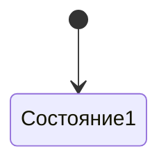

# Имя объекта

## Что это
Одна фраза словами пользователя.

## Состояния

## Действия
Что пользователь делает с объектом.

## Критерии приёмки
- Дано …, когда …, тогда …
  Проверка: `bin/check` / ручной сценарий / экранный снапшот.

## Границы
Чего в объекте нет и почему.

## Вопросы
Только вопросы к пользователю. Без догадок.

## Предложения машины (не канон)
Формулировки на подтверждение. Удаляется после решения.
